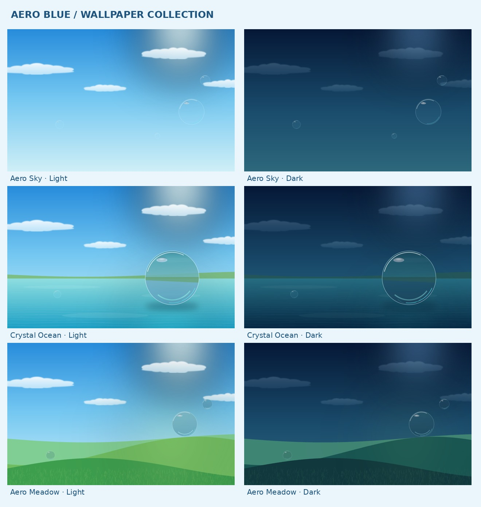

# AERO BLUE

A calm crystal-blue desktop toolkit for macOS, inspired by Aqua and Frutiger Aero. It includes original artwork, a native SwiftUI control center, six Übersicht widgets, optional menu-bar styling, and reversible wallpaper, Dock and file-icon changes.



**The code and assets are implemented. The development machine is Linux, so the native macOS build and desktop behavior still require verification on your Mac.** Nothing in this cloud session changes your Mac. No published cloud environment configuration is changed by this project.

## Included

- **Six wallpapers:** Aero Sky, Crystal Ocean and Aero Meadow, each in light and dark variants at 3200 × 2000, with smaller selection previews and an original procedural source generator.
- **17 crystal icons:** Finder, Safari, Mail, Messages, Music, Photos, Calendar, Notes, Settings, Terminal, VS Code, Downloads, Documents, Projects, Applications, Trash and Desktop folders. Seven PNG sizes and ICNS files; existing application bundles remain protected.
- **Ten cursor roles:** normal pointer, text, hand, loading, horizontal/vertical/diagonal resize, move, crosshair and unavailable. Transparent 64px/128px assets, exact hotspots, native in-app preview and manual import instructions. Global replacement is not asserted.
- **Six glass widgets:** clock, Open-Meteo weather, real system measurements, Apple Music controls, calendar and a persistent checklist/focus timer. Each has independent visibility and position settings.
- **Aero Blue Control Center:** galleries, presets, permissions, widget settings, Dock preferences, animation controls, optional native menu extra and restore actions.
- **Four presets:** Pure Aero, Aqua Minimal, Crystal Ocean and Sky Blue Elegance.
- **Installation and restore tools:** user-level installation, local backups before theme changes, protected-location checks and explicit authorization for modifications.

## Start on your Mac

Requirements: **macOS 13+**, **Swift 5.9 / Xcode 15+ developer tools**, and **Python 3.9+**. Build on the Mac where the app will run, using a toolchain supported by that macOS release. Übersicht, Mousecape and SketchyBar are optional and are never installed automatically. Read [compatibility evidence](docs/compatibility.md) before choosing optional software.

If you downloaded GitHub's ZIP for the `aero-blue` branch, extract it and open `oceansense-aero-blue/aero-blue`. This inner folder contains `scripts`, `assets` and `swiftui-app`. In Terminal, type `cd` followed by a space, drag that inner folder into the window, then press Return. Run the commands below starting with `bash scripts/check-system.sh`.

From a Git checkout of this repository on your Mac:

```bash
cd oceansense/aero-blue
bash scripts/check-system.sh
bash scripts/install.sh
open "$HOME/Applications/Aero Blue Control Center.app"
```

The checker reports the Mac/architecture, OS build, displays, tools and existing customizations. If developer tools are missing, review Apple's installation instructions and install them yourself, then repeat the check. The installer displays its plan and asks you to type `yes`; in a deliberately authorized noninteractive session, use `bash scripts/install.sh --yes`.

Installation builds locally and installs the app and resources. It does not apply the theme. In Control Center, select a wallpaper or preset, review Dock options, then choose **Apply** and confirm the backup-and-apply action. Changes are limited to connected displays' wallpaper and the Dock's size, magnification and autohide preferences. A Dock restart refreshes those preferences. Wallpaper behavior across Spaces must be checked locally.

This is source code for a locally built app, not a downloaded notarized release. The build uses local ad-hoc signing when available and preserves normal security checks. Never disable SIP or Gatekeeper to use Aero Blue.

## Widgets, cursors and icons

**Widgets:** install a compatible Übersicht release yourself if desired, open it once, then select **Install widgets** in Control Center. Enable the theme, switch on individual panels and save their positions. Select a weather city or coordinates; there are no hardcoded temperatures. Connect Music and Calendar explicitly if you want those integrations. Übersicht controls display selection, interaction shortcuts and its own Accessibility permission. See [widget instructions](docs/widgets.md).

**Cursors:** open the Crystal Cursor gallery and move over the preview area to test an original cursor inside the app. System-wide theming is optional and unverified. Start with the supported **System Settings → Accessibility → Display → Pointer** fill/outline colors. The [asset guide](docs/assets.md) contains exact image sizes, hotspots and a manual Mousecape import workflow. Aero Blue neither patches system cursor resources nor installs a cursor helper.

**Icons:** select a crystal icon and a file or folder you own, review the target and confirm. The helper saves its existing icon metadata before changing it. Application bundles are deliberately excluded, including third-party signed applications. For application shortcuts, create a Finder alias outside the original app bundle and use it only where Finder supports a separate custom icon; validate alias behavior before applying a collection of changes. You can also create themed personal folders without changing applications.

**Menu bar:** the native menu extra provides a compact optional companion. The existing system menu remains available. Users who already have SketchyBar can opt into the separate session described in [widget and menu-bar documentation](docs/widgets.md). No login service is installed.

## Restore and uninstall

Control Center's restore action returns wallpaper and the three Dock preferences to their saved pre-theme values. This is a restore of **your previous settings**, not a factory reset. Individual icon backups can be restored from the Icons page.

```bash
# Review and restore the original theme snapshot:
bash scripts/restore-defaults.sh

# Or select a specific backup identifier:
bash scripts/restore-defaults.sh --backup BACKUP_ID

# Restore managed changes and archive the installation:
bash scripts/uninstall.sh
```

Backups, tasks and archives live under `~/Library/Application Support/Aero Blue/`. Uninstall retains them; it does not delete your files. An unsuccessful restore reports the affected item and retains its backup. Review the actual results before removing archives yourself.

Manual changes in another cursor manager, Accessibility settings, Übersicht preferences or Login Items must be reversed in the tool where you made them. Record those settings before changing them. Aero Blue does not pretend to restore settings it did not manage.

## Development and verification

```bash
# Portable validation from aero-blue/:
python3 -m unittest discover -s tests -v
node widgets/aero-blue/helpers.test.mjs

# Native build on macOS only:
bash scripts/build-app.sh
```

No Python package installation is required to run the backend. Asset regeneration alone needs Pillow; see [the original artwork guide](docs/assets.md). Read-only diagnostics are available with `python3 scripts/aero.py check`. `--help` lists commands; modifying macOS commands require `--yes`. A running app or widget does not survive cloud snapshots; these components run on your Mac.

The [verification report](docs/verification.md) distinguishes completed portable checks from pending native tests. A GitHub Actions workflow defines Linux tests and a macOS build, but adding a workflow does not mean it has run. Use the [Mac acceptance checklist](docs/mac-verification.md) for build, restore, display scaling, cursor hotspots, permissions, rendering, power use and login behavior.

## Project layout

```text
aero-blue/
├── assets/          # Original PNG/ICNS artwork, manifest and contact sheets
├── config/          # Validated defaults and four theme presets
├── docs/            # Compatibility, design, usage and verification
├── widgets/         # Installable Übersicht bundle and panel documentation
├── menu-bar/        # Optional isolated SketchyBar session
├── swiftui-app/     # SwiftUI app and native AppKit/EventKit/IOKit bridge
├── scripts/         # Installer, backend, backup/restore, build and artwork generator
├── tests/           # Portable behavior and asset tests
└── backups/         # Documentation only; personal backups stay outside Git
```

Weather attribution: [Open-Meteo](https://open-meteo.com/) supplies current conditions, geocoding and forecast data under its service terms. All included visual artwork is original procedural work; application names identify associations and do not imply vendor endorsement.
